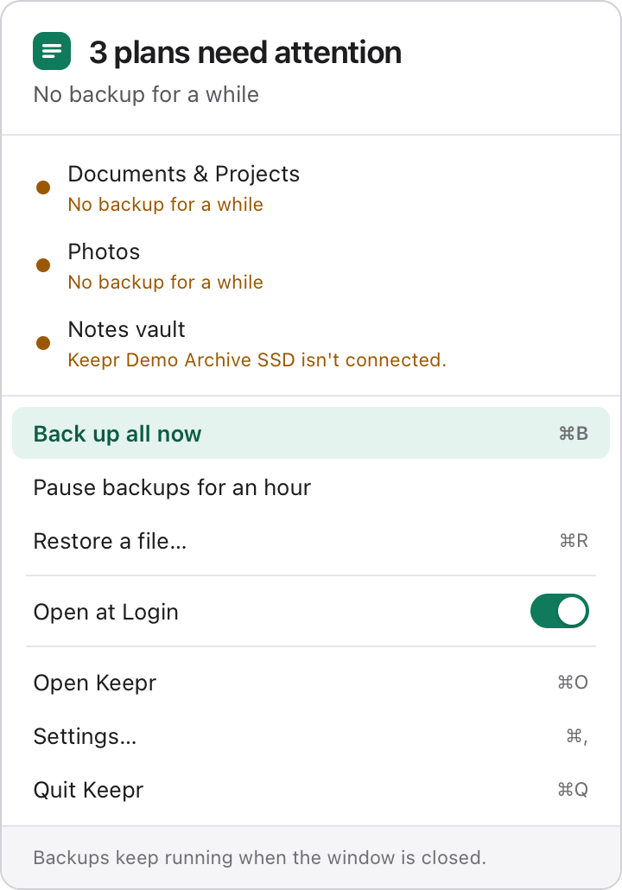
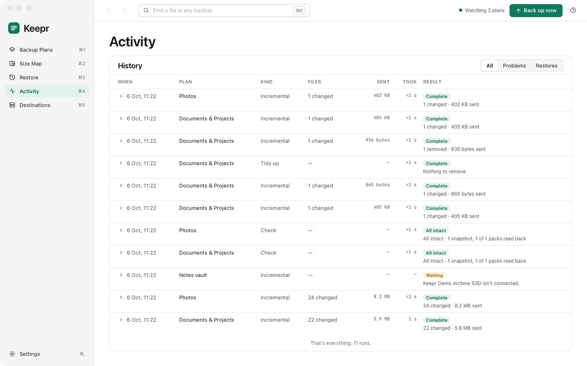
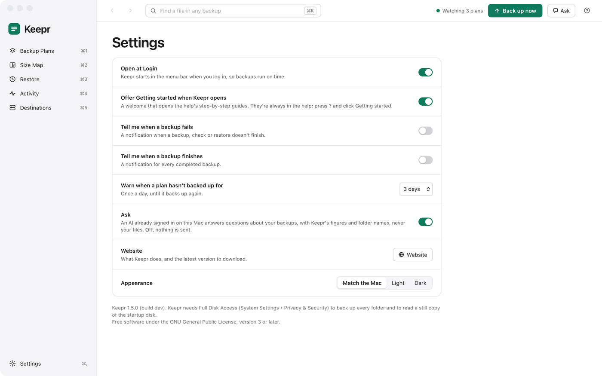
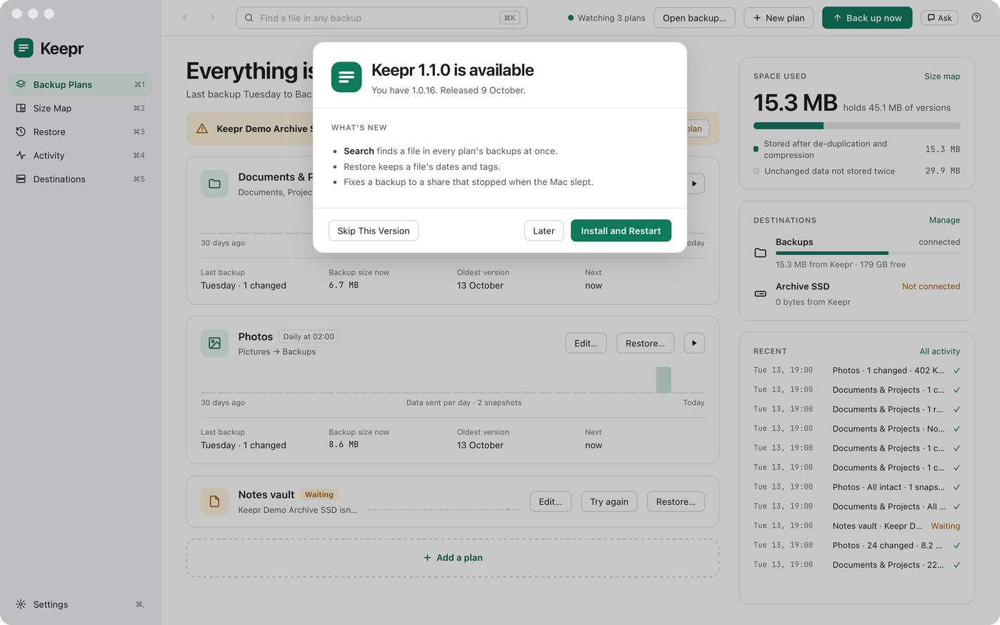
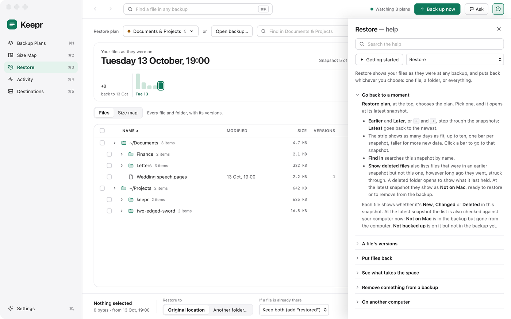

# Day to day

Once your plans are set up, Keepr backs up on its own from the menu bar (on Windows, the notification area), whether or not its window is open. This page is about keeping an eye on it: the menu bar, Activity, notifications and Settings, and what Keepr does in the background.

[The menu bar](#the-menu-bar) · [Activity](#activity) · [Notifications](#notifications) · [Settings](#settings) · [Help](#help) · [In the background](#in-the-background) · [How backups are stored](#how-backups-are-stored) · [On Windows](#on-windows)

## The menu bar

<a href="images/index.md#day-to-day"><picture><source media="(prefers-color-scheme: dark)" srcset="images/menu-bar-dark.png"></picture></a>

Keepr's icon in the menu bar (on Windows, the notification area, at the right of the taskbar) shows a dot while it's backing up, and a mark when a plan needs attention. Click it<!-- windows --> (with either button on Windows; from a taskbar at the foot of the screen the panel opens above the icon)<!-- /windows --> for:

- Whether everything is kept, and what needs attention if not.
- The backup that's running, with its progress and the time left.
- Each plan's last and next backup, or its problem. Click one to open Keepr.
- **Back up all now** (⌘B), **Pause backups for an hour** (which also stops the backup that's running), **Restore a file…** (⌘R), **Open Keepr** (⌘O), **Settings…** (⌘,)<!-- windows -->, **Keepr Help** and **Check for Updates…** (Windows has no Keepr menu)<!-- /windows --> and **Quit Keepr** (⌘Q), which asks first.
- An **Open at Login** switch, the same one as in [Settings](#settings), in the installed app.

## Activity

Activity (⌘4) shows the backup that's running, step by step: looking for changes, comparing, packing (splitting, skipping what's already kept, compressing and encrypting), sending, and confirming. It has the progress, the speed and the time left, how much was already stored and skipped against how much is new, and **Pause** and **Stop**.

If the computer sleeps or the destination drops off, the next backup picks up the work. Nothing half-sent counts as a snapshot, and **Stop** waits for the file it's on.

<a href="images/index.md#day-to-day"><picture><source media="(prefers-color-scheme: dark)" srcset="images/activity-dark.png"></picture></a>

Below it is the **History** of every backup, full re-read, check, tidy-up and restore, with when it ran, how many files and how much data, how long it took and its result. Each change to a plan made with Ask is there too, with **Undo**, which puts back the settings it changed. **All**, **Problems** and **Restores** filter it. Click a row for its log, which says what was backed up, skipped or couldn't be read; **Ask**, under the log, asks an AI what happened.

## Notifications

- **Tell me when a backup fails** (on unless you turn it off): a backup, check or restore that didn't finish.
- **Tell me when a backup finishes** (off unless you turn it on).
- **Warn when a plan hasn't backed up for** 1 to 14 days (3 unless you change it): once a day until it backs up. Plans that back up only when you ask aren't warned about.

A check that finds a problem with the stored data always tells you.

## Settings

<a href="images/index.md#day-to-day"><picture><source media="(prefers-color-scheme: dark)" srcset="images/settings-dark.png"></picture></a>

- **Open at Login** starts Keepr when you <!-- mac -->log in, in the menu bar with no window. It's the same setting as System Settings › General › Login Items<!-- /mac --><!-- github --> (Mac) or <!-- /github --><!-- windows -->sign in, in the notification area with no window. It shows in Windows' Settings › Apps › Startup; switched off there, Keepr opens that page for you to switch it back on<!-- /windows --><!-- github --> (Windows)<!-- /github -->.
- The [notifications](#notifications) above.
- **Ask** turns on [Ask](features.md#ask). Off, nothing is sent.
- **Website** opens [keepr.davies.co.za](https://keepr.davies.co.za/) in your browser. It's also under Help › **Keepr Website**, and in **About Keepr** in the Keepr menu<!-- windows --> (on a Mac; Windows has no Keepr menu)<!-- /windows -->.
- **Appearance**: **Match the Mac** (**Match Windows** on Windows), **Light** or **Dark**.

The foot of Settings shows Keepr's version and build, and its licence.

## Updates

Keepr checks for a new version once a day, and Keepr › **Check for Updates…** checks now<!-- windows --> (on Windows, **Check for Updates…** beside **Website** in Settings or in the notification-area panel). A Windows update reaches a release some minutes after the Mac's, and installs with no questions from the installer<!-- /windows -->. When there is one, it asks in its window, once the window is in front, with what's new in that version:

- **Install and Restart** downloads it, showing how far it has got, installs it and opens the new version. If a backup, restore or check is running or about to, or Ask is answering, the update waits for another time.
- **Later** (or Esc) asks again tomorrow.
- **Skip This Version** doesn't ask about this version again. **Check for Updates…** still offers it.

<a href="images/index.md#day-to-day"><picture><source media="(prefers-color-scheme: dark)" srcset="images/update-dark.png"></picture></a>

## Help

Press `?`, click **?** at the right of the toolbar, or choose Help › **Keepr Help** (⌘?; on Windows Ctrl+? or the notification-area panel's **Keepr Help**) to open help for the screen you're on, at the side of the window. It stays open while you use the screen; Esc or × closes it. Help and Ask share the side of the window, so opening one closes the other.

<a href="images/index.md#day-to-day"><picture><source media="(prefers-color-scheme: dark)" srcset="images/help-dark.png"></picture></a>

- **Search the help** searches every topic.
- **Getting started**, under the search, lists the step-by-step guides: Start here, Get a file back, Keep an eye on it, Ask about your backups, Back up to a NAS or the cloud, Choose what's backed up and kept, Make backups smaller, Move to a new computer, Run something before or after a backup, and Make sure a backup restores. Each step has links that take you to the screen it's about, and a finished guide is marked **Done**.
- **All topics**, beside it, opens the help for any part of Keepr. **Keyboard shortcuts** is one of them, opened at the keys for the screen you're on.
- A topic shows one section at a time: opening another closes the one that was open.

When Keepr opens, a welcome offers Getting started, until you tick **Don't ask me again** or turn off **Offer Getting started when Keepr opens** in Settings.

The help shows only this computer's instructions, with its shortcuts in its own words (Ctrl on Windows).

## In the background

- **One job at a time.** Backups, restores, checks and tidy-ups queue up and run one after another.
- **Waiting.** A backup that's due waits while its destination isn't connected, the battery is low, or the computer is on a hotspot or a metered connection (as the plan says), and tries again every few minutes.
- **Tidying up.** After a backup, at most once a day, Keepr thins out old snapshots by the plan's [Versions to keep](plans.md#versions-to-keep), and frees the space nothing uses any more.
- **Still copies.** On a Mac, for folders on its own disk, Keepr takes a still copy of the disk (an APFS snapshot, as Time Machine does) and backs up from that, so files that change during the backup are copied as they were at one moment. The copy is deleted afterwards. Time Machine's own snapshots are never touched. Drives, shares, cloud folders and buckets are read as they are. On Windows a still copy (Volume Shadow Copy) needs an administrator, so it's made by **Keepr Helper**, a small Windows service installed from Settings › **Still copies and the change journal** (Windows asks for an administrator once). With it, for folders on one of the PC's own NTFS drives, each backup reads a shadow copy of the drive, deleted afterwards; without it, files are read as they are.
- **Changes since the last backup.** On a Mac, for folders on its own disk, Keepr asks macOS which folders have changed since the last backup, and only looks in those. On Windows, with Keepr Helper installed, Keepr asks the drive's change journal the same; without it each backup looks at every file, compares its size and times with the last snapshot and reads only those that changed. A full re-read looks at everything.

## How backups are stored

Each plan's backup is a folder at its destination, named after the plan, holding packs of data, an index and the snapshots.

- Files are split into pieces by their content, and each piece is stored once, however many files, folders and snapshots have it. A file that moves or is copied costs nothing more.
- Pieces are compressed (zstd), unless they're already compressed.
- An encrypted plan's pieces and snapshots are encrypted with XChaCha20-Poly1305 under a random key, which is itself locked with your password (through Argon2id) and, separately, with the recovery key. That's why changing the password rewrites nothing else.
- A snapshot is written last, after everything it needs, so a backup that's stopped or cut off never leaves a broken snapshot.

Keepr's own settings and history are in `~/Library/Application Support/Keepr`, or on Windows `%APPDATA%\Keepr`.

## On Windows

Keepr runs on Windows 10 and 11 (64-bit) as it does on a Mac, with Windows' own parts where a Mac has others:

| On a Mac | On Windows |
|---|---|
| Paths as `/Users/alex/Documents`, `~/Documents` | Paths as `C:\Users\alex\Documents`. Leave-out rules are still written with `/`: `~/AppData/Local/Temp`, `D:/Scratch`, and match in any case |
| The menu bar | The notification area; either button opens the panel |
| The Keepr and Help menus | **Keepr Help** and **Check for Updates…** in the notification-area panel, Help on Ctrl+?, Check for Updates… beside Website in Settings, and the version at the foot of Settings |
| Passwords in one Keychain item, Keepr | Passwords in Credential Manager, one for each, named Keepr/… (Control Panel › Credential Manager › Windows Credentials); Windows never asks |
| Settings in `~/Library/Application Support/Keepr` | Settings in `%APPDATA%\Keepr`, removed when you uninstall with Delete the application data ticked |
| A still copy of the startup disk for each backup | A shadow copy of the drive, with Keepr Helper installed (Settings); without it, files read as they are |
| macOS's record of changed folders | The drive's change journal, with Keepr Helper; without it, every file compared with the last snapshot by size and times |
| Skip what apps mark for backups to skip | Not there: Windows has no such mark |
| Quick Look | **Open**: the version from the backup opens in its own app |
| Show in Finder | Show in File Explorer |
| Shares mounted out of sight of Finder | Shares connected as `\\server\share`, with no drive letter; with no password entered, Windows uses the one it saved for the server |
| Cloud folders in ~/Library/CloudStorage and iCloud Drive | The sync folders Windows knows (OneDrive, iCloud for Windows, Dropbox, Box), and Google Drive's drive |
| Commands before and after a backup in zsh | Commands in PowerShell (`$env:KEEPR_RESULT`) |
| Amazon S3 set up by signing in with the AWS CLI or in CloudShell | Amazon S3 set up in CloudShell |
| Open at Login in Login Items | Open at Login in the Run key, shown in Settings › Apps › Startup |
| Full Disk Access to read every folder | Nothing to grant; folders only an administrator can open are skipped and logged |

A backup made on one opens on the other with **Open backup…**: a Mac's `/Users/alex/Documents` is a PC's `C:\Users\alex\Documents`. Restore to **Another folder…** when the folders aren't there.
